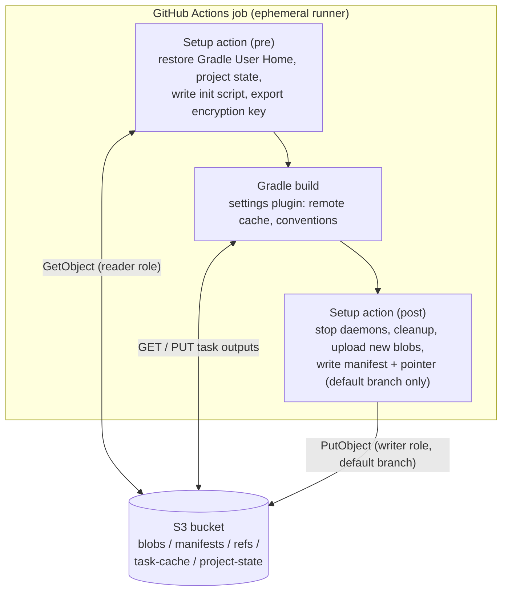
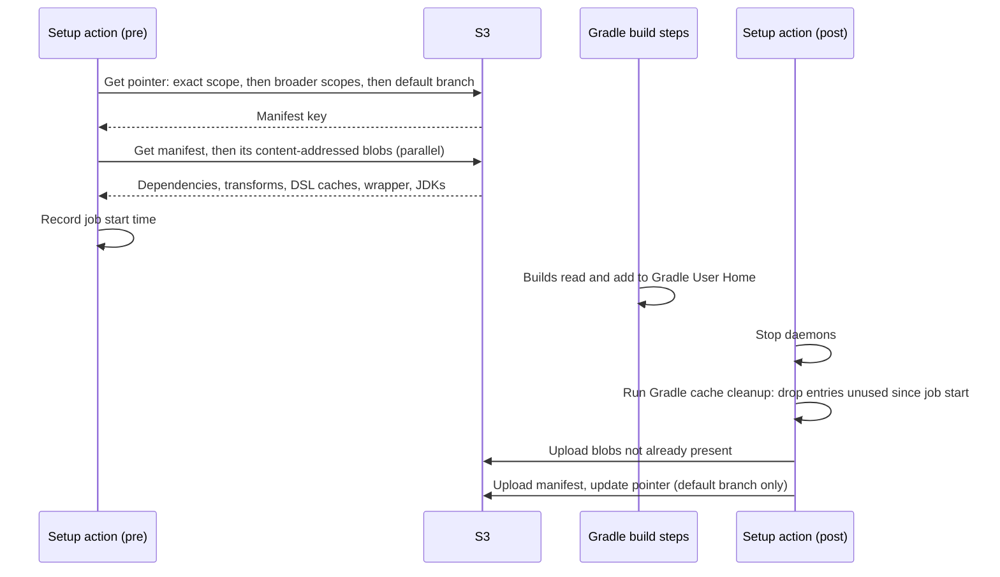
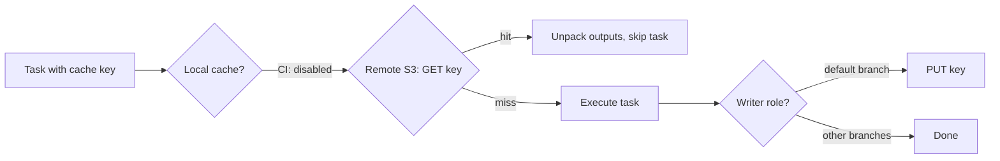

# Gradle CI caching

A study of what Gradle caching on GitHub Actions could look like at its best, for a common setup: ephemeral runners, self-hosted in AWS, with an S3 bucket available. It sets out an ideal design: its shape, what it restores and writes, how it keys, evicts and trusts writes, and which build conventions it applies. It then tests the design's main claims against two public builds.

The two builds, an Android app and a Spring Boot API server, ran under three existing options:

- **basic**: `gradle/actions/setup-gradle` v6 with `cache-provider: basic`. It is often paired with [burrunan/gradle-s3-build-cache](https://github.com/burrunan/gradle-s3-build-cache) for task outputs (called **Basic + S3** below). That pairing was not measured: no S3 bucket was used, and the measured basic variant keeps task outputs in the local build cache inside its tarball of `caches/` and `wrapper/`.
- **Enhanced**: `gradle/actions/setup-gradle` v6 with its default provider, the closed-source `gradle-actions-caching` library.
- **v5**: `gradle/actions/setup-gradle` v5.0.2, the last release whose fine-grained caching is open source (MIT).

A fourth variant, **sim**, adds parts of the ideal design to v5 to test its main claims.

There is no implementation. The ideal design is a reference point for the measurements. The measurement harness is [gradle-cache-harness](https://github.com/ryanlewis/gradle-cache-harness).

The study was built with AI assistance: Claude Opus 5.5 built the harness, and Claude Fable 5.1 verified the results.

## Contents

- [Findings, ranked by measured value](#findings-ranked-by-measured-value)
- [Ideal design](#ideal-design)
- [What can be cached](#what-can-be-cached)
- [Mechanics of each layer](#mechanics-of-each-layer)
- [Storage design on S3](#storage-design-on-s3)
- [Build conventions](#build-conventions)
- [Comparison with existing options](#comparison-with-existing-options)
- [Measurements](#measurements)
- [Judging an implementation](#judging-an-implementation)
- [Open questions](#open-questions)
- [Sources](#sources)
- [Appendix A: The GitHub Actions cache as the backend](#appendix-a-the-github-actions-cache-as-the-backend)
- [Appendix B: AWS transfer, request and key costs](#appendix-b-aws-transfer-request-and-key-costs)
- [Appendix C: EBS instead of S3](#appendix-c-ebs-instead-of-s3)
- [Appendix D: How the harness observes Enhanced](#appendix-d-how-the-harness-observes-enhanced)

## Findings, ranked by measured value

1. **Restore fallback for Gradle User Home.** After a build-file or version-catalogue edit, a cache keyed on build files (basic) starts empty. Measured with basic alone, that costs about 7 minutes on the Android build and about 5.5 minutes on the Spring Boot build. Falling back to the nearest earlier entry costs 40–90 seconds. With an S3 build cache beside basic, task outputs would survive the edit and the cost would be lower; that was not measured.
2. **Task outputs in their own store, not in Gradle User Home.** Per-job cleanup of Gradle User Home deletes task outputs the current job didn't use. Switching back to an earlier dependency set then rebuilds work that had already been cached. A separate content-addressed store, expired by age, keeps it. *sim* confirmed this on Android: going back to the original versions, it got 316 tasks from cache, against 302 for v5 and Enhanced.
3. **Fine-grained, content-addressed entries.** A one-library bump added 10 MB of new dependency and transform files on Android. v5 and Enhanced re-uploaded 940 MB of bundles.
4. **Project state for the configuration cache.** The configuration cache is reused across commits, including source-only edits, but only if three things hold:
   - the runner's kernel release is the same (Gradle checks `os.version`);
   - the included `build-logic` build's outputs are restored;
   - files the build generates inside the source tree are restored.

   Without these, the first Gradle call in a fresh checkout never reuses it. It's worth about 18 seconds per warm Android build.
5. **Build conventions.** These matter most where caching can't help: parallel execution, Spring's dependency-management plugin, and tasks that are deliberately uncacheable. On Android the ~230 uncacheable tasks cost 7–11 seconds per warm build, so they aren't worth chasing.

Enhanced adds two things over the open v5 code:
- the local build cache stored as its own entry;
- a configuration-cache-plus-build-logic feature gated behind a Develocity licence.

An open design can do both. During the measured runs, Enhanced contacted no hosts beyond GitHub's and the build's own repositories.

## Ideal design

Three parts. A repository would only need to change one `uses:` line, because the action applies the plugins through an init script.



### Example workflow

There is no implementation, so this example is illustrative: the action name `<owner>/gradle-s3-cache` and its inputs are placeholders. It shows what a repository would write.

```yaml
name: build

on:
  push:
    branches: [main]
  pull_request:

permissions:
  contents: read

jobs:
  build:
    runs-on: [self-hosted, linux]
    permissions:
      contents: read
      id-token: write # GitHub OIDC token, exchanged for the S3 reader or writer role
    steps:
      - uses: actions/checkout@<sha> # vX.Y.Z

      - uses: actions/setup-java@<sha> # vX.Y.Z
        with:
          distribution: temurin
          java-version: 21

      # Replaces gradle/actions/setup-gradle. Restores Gradle User Home and project state from S3,
      # applies the S3 build cache and convention plugins through an init script, and saves after the job.
      - uses: <owner>/gradle-s3-cache@<sha> # vX.Y.Z
        with:
          bucket: ci-gradle-cache
          region: eu-west-2
          reader-role: arn:aws:iam::123456789012:role/gradle-cache-reader
          # Assumed only when the job runs on the default branch; the role's trust policy enforces it
          writer-role: arn:aws:iam::123456789012:role/gradle-cache-writer
          encryption-key: ${{ secrets.GRADLE_ENCRYPTION_KEY }}
          # Paths the build generates inside the source tree, restored as project state
          generated-paths: |
            app/src/*/generated

      - run: ./gradlew build
```

The repository's own build scripts don't change. The `buildCache {}` block, the local build cache switch and the conventions all come from the init script the action writes. On a pull request the job gets the reader role only, so it restores and reads from S3 but never writes.

### 1. Setup action

Runs before and after the build steps, because Gradle User Home and project state must be on disk before Gradle starts and saved after the daemon stops. A Gradle plugin can't do this.

| Does | Detail |
|---|---|
| Restores Gradle User Home | Reads a pointer for the closest scope (repo → branch → OS/arch → job → matrix), falls back to broader scopes and then the default branch, then fetches the manifest's content-addressed blobs in parallel |
| Restores project state | Configuration cache directories, the included build's outputs and declared generated paths, keyed by build-logic inputs **and the kernel release** (`uname -r`, which Gradle checks as `os.version`) |
| Configures Gradle | Writes an init script that applies the settings plugin and turns the local build cache off. Exports `GRADLE_ENCRYPTION_KEY` from the secret store |
| Saves (default branch only) | Stops daemons, runs Gradle's cache cleanup with the build's own distribution, uploads only blobs that don't exist yet, writes the manifest and pointer |
| Reports | Job summary plus metrics: restore and save time, bytes, hits and misses per layer, configuration cache hit and miss reason |

### 2. S3 build cache plugin (settings plugin)

Replaces burrunan, keeping what it does well and adding what's missing.

| Keeps from burrunan | Adds |
|---|---|
| One `GetObject` per lookup, no `ListBucket`, 403 treated as a miss | Credentials from GitHub OIDC roles (reader everywhere, writer only on the default branch) |
| Streams files, no buffering | Applies to included builds (`build-logic`) as well |
| `maximumCachedObjectLength` cap | Refreshes hot objects from default-branch jobs so age-based expiry doesn't evict them (see [Eviction](#eviction)) |
| KMS encryption | Per-build metrics: hits, misses, time saved, bytes |
| Per-entry metadata (task, execution time) | Push only where the writer role is available, decided by credentials and not by a flag |

### 3. Convention plugin

Applies the settings and task conventions that make cache keys stable, and reports what it can't fix. See [Build conventions](#build-conventions). The parts differ per build shape: Android builds need transform and AGP flags, Spring Boot builds need parallel execution and native BOM imports.

## What can be cached

| Layer | Location | Produced by | Saved by reuse | Who restores it |
|---|---|---|---|---|
| Dependencies | `~/.gradle/caches/modules-2/` | Dependency resolution | Downloads (cheap with an in-region proxy) | Action, before Gradle starts |
| Wrapper distribution | `~/.gradle/wrapper/dists/` | `./gradlew` first run | Download + unzip | Action |
| Java toolchains | `~/.gradle/jdks/` | Toolchain provisioning | JDK download + unpack | Action, or the runner image |
| Gradle-generated jars | `~/.gradle/caches/<version>/generated-gradle-jars/` | Gradle API jar generation | Seconds per Gradle version | Action |
| Kotlin DSL / Groovy DSL caches | `~/.gradle/caches/<version>/kotlin-dsl/`, `groovy-dsl/` | Script compilation, accessor generation | Compiling every build script | Action |
| Artifact transforms, instrumented jars | `~/.gradle/caches/transforms-*/`, `caches/<version>/transforms/`, `caches/jars-*/` | AGP and Kotlin transforms, classpath instrumentation | On Android, the largest single cost of a cold build | Action |
| Configuration cache | `<project>/.gradle/configuration-cache/` | Configuration phase | The whole configuration phase | Action, with project state |
| Project state | `build-logic/*/build/`, generated paths in the source tree | Included build, plugins that generate into `src/` | Lets the first Gradle call reuse the configuration cache | Action |
| Task outputs | Remote build cache | Cacheable tasks | Task execution | Gradle, through the settings plugin |

## Mechanics of each layer

### Gradle User Home



**Keys.** The home entry key runs from most specific to least specific. In v5 and Enhanced it is:

```
gradle-home-v1|<os>-<arch>|<job>[<hash(workflow, matrix)>]-<sha>
```

Restore tries the exact key first. It then falls back to the most recent entry for the same job and matrix, then the same job, then the same OS. Each level is tried on the current branch, then the default branch. On S3, the ideal design writes a small pointer object per scope on every save, so restore is a short chain of `GetObject` calls with no prefix listing.

**Extracted entries.** These are the definitions in the v5 code (Enhanced creates the same set, plus the local build cache):

| Entry | Pattern | Stored as | Key from |
|---|---|---|---|
| `generated-gradle-jars` | `caches/*/generated-gradle-jars/*.jar` | One entry per file | File names |
| `wrapper-zips` | `wrapper/dists/*/*/` | One entry per distribution | File names |
| `java-toolchains` | `jdks/*/` | One entry per JDK | File names |
| `dependencies` | `caches/modules-*/files-*/*/*/*/*` | One bundle | File names |
| `instrumented-jars` | `caches/jars-*/*/` | One bundle | File names |
| `kotlin-dsl` | `caches/*/kotlin-dsl/accessors/*/`, `caches/*/kotlin-dsl/scripts/*/` | One bundle | File names |
| `groovy-dsl` | `caches/*/groovy-dsl/*/` | One bundle | File names |
| `transforms` | `caches/transforms-4/*/`, `caches/*/transforms/*/` | One bundle | File names |

Keying by file names works because Gradle names these directories after content hashes.

The bundles are the problem. Any change produces a new bundle: one library bump re-uploaded 532 MB of dependencies and 410 MB of transforms (compressed) for 10 MB of new content. The ideal design stores one object per dependency file, or per small group of them, and one per transform directory. The manifest lists them. Save uploads only objects that don't exist yet, which needs a `HeadObject` per new object, or a local index of what was restored.

**Cleanup.** Gradle tracks when each cache entry was last used. v5 records the job start time, then runs a throwaway Gradle build with an init script:

```
settings.caches {
    cleanup = Cleanup.ALWAYS
    releasedWrappers.setRemoveUnusedEntriesOlderThan(jobStart)
    snapshotWrappers.setRemoveUnusedEntriesOlderThan(jobStart)
    downloadedResources.setRemoveUnusedEntriesOlderThan(jobStart)
    createdResources.setRemoveUnusedEntriesOlderThan(jobStart)
    buildCache.setRemoveUnusedEntriesOlderThan(jobStart)
}
```

Anything not touched during the job is deleted before save. That keeps the home from growing, but anything stored inside the home is subject to it, which is why task outputs must live elsewhere. Skip cleanup when:
- the build failed;
- the cache is read-only;
- the configuration cache was hit, because Gradle then touches less.

v5 provisions a separate Gradle distribution for this. Its save steps took 9–44 seconds. The ideal design uses the distribution the build already used.

**Daemon.** Stop daemons before saving, or files are locked and half written.

**Read-only dependency cache.** `GRADLE_RO_DEP_CACHE` points Gradle at a read-only `modules-2` copy, for example one baked into the runner image. Anything missing goes to the writable cache. It doesn't cover transforms, DSL caches or the configuration cache, so it can only add to the action.

### Configuration cache

- **Location.** `<project>/.gradle/configuration-cache/`, not Gradle User Home.
- **Encryption.** Entries can hold secrets resolved at configuration time. The key must come from `GRADLE_ENCRYPTION_KEY`, not the per-machine `cc-keystore`, which v5 deliberately excludes from the cache.
- **Restore only after a full home restore.** Entries refer to files in Gradle User Home. v5 restores the configuration cache only if every home entry came back.
- **Gradle 8.6 or later.**
- **What invalidates it in practice.** These are the reasons Gradle gave in the measured runs:

  | Reason given by Gradle | Cause | Ideal design's answer |
  |---|---|---|
  | `system property 'os.version' has changed` | The job ran on a runner with a different kernel release than the job that stored the entry. In the measured runs this mostly followed the two runner image versions, but not always: one *sim* run reused an entry stored on the other image | Include the kernel release in the project-state key (untested: *sim*'s key did not include it). On self-hosted runners, keep AMIs pinned |
  | `an input to task ':build-logic:convention:processResources' has changed` | The included build's outputs (generated plugin descriptors) don't exist on a fresh checkout | Restore `build-logic/*/build/` as project state |
  | `the file system entry 'app/src/demoRelease/generated/baselineProfiles' has been removed` | A plugin generates files into the source tree, which a fresh checkout doesn't have | Restore declared generated paths as project state, or move generation under `build/` |
  | Any build-file or version-catalogue change | Expected | None needed |

  With `build-logic` outputs and generated paths restored (*sim*), and the kernel release matching, the first Gradle call in a fresh checkout reused the configuration cache on a source-only commit: `help` took 7–8 s, against 11–20 s for the other providers. Reuse in a later call of the same job took a warm Android build from 34–40 s to 17 s.

### Remote build cache (task outputs)



- On CI, the local build cache is off. Enhanced and v5 keep it in Gradle User Home, where cleanup purges whatever the current job didn't use.
- Reads are one `GetObject` per key. With only `s3:GetObject`, S3 returns 403 Access Denied for a missing key, not 404, so the plugin treats 403 as a miss, as burrunan does. Granting `s3:ListBucket` on the task-cache prefix turns misses into 404s.
- Per-entry metadata (task path, execution time) makes time saved measurable.

### Build logic

Convention plugins in `build-logic` are an included build. Their outputs land in `build-logic/*/build/`, outside Gradle User Home. The remote build cache can serve their task outputs, but the configuration cache fingerprint check runs before any task does, so the outputs must be on disk before Gradle starts. That's why they are project state, restored by the action.

## Storage design on S3

### Key layout

```
s3://<bucket>/
  task-cache/<cache-key>                                   # task outputs, content-addressed
  home/blobs/<type>/<content-key>                          # dependency files, transforms, DSL caches, wrappers, JDKs
  home/manifests/<repo>/<home-key>                         # home entry: blob list + small files
  home/refs/<repo>/<branch>/<os-arch>/<job>/<matrix>       # pointer → latest manifest for this scope
  project-state/<repo>/<kernel>/<build-logic-hash>/<sha>   # configuration cache, build-logic outputs, generated paths
  project-state/refs/<repo>/<branch>/<kernel>/<build-logic-hash>
```

- **Content-addressed objects can be shared across repositories.** Same key means same content, so collisions are not a risk. Who can write is, which is a tenancy decision (see [Open questions](#open-questions)).
- **Pointers instead of listing.** Restore never needs `ListBucket`.
- **Project state is per repo, kernel release and build-logic hash.** It is only valid when all three match.

### Transfer

- Gateway VPC endpoint: free, and no NAT gateway data charges.
- Parallel fetches, with ranged GETs for large objects.
- zstd for manifests and project-state bundles. Task cache entries are already compressed by Gradle.
- Restore from GitHub's cache storage measured 12–25 seconds for about 1.1 GB, with one outlier at 81 seconds. In-region S3 is untested.

### Eviction

- S3 lifecycle rules expire by age since creation, not last access.
- Task cache and blobs:
  - a generous expiry (14–30 days);
  - the plugin refreshes an object when it is hit and older than half the expiry, so hot entries never expire. The refresh is an in-place `CopyObject`, which needs `x-amz-metadata-directive: REPLACE` (S3 rejects a plain self-copy) and `PutObject`. Only default-branch jobs have the writer role, so entries hit only by pull-request builds still age out.
- Shorter expiry for `refs/`, `manifests/` and `project-state/`, since a stale pointer only costs a fallback.

### Write trust

- Instance profiles can't tell a default-branch job from a pull-request job. Use GitHub OIDC:
  - **Reader role**, available to every job: `GetObject`.
  - **Writer role**, only when the token's `sub` is `repo:<org>/<repo>:ref:refs/heads/<default-branch>`: adds `PutObject`.
- This enforces default-branch-only writes in IAM. A compromised pull-request build can't poison the cache.
- Repositories created after 15 July 2026 use an immutable `sub` by default, `repo:<owner>@<owner-id>/<repo>@<repo-id>:ref:refs/heads/<branch>`. The writer condition has to match that form for them.

### Encryption

- SSE-KMS as the bucket default, with the key policy limited to the runner roles.
- The configuration cache is also encrypted by Gradle, with `GRADLE_ENCRYPTION_KEY` from the secret store.

## Build conventions

The convention plugin applies these and reports what it can't fix.

### All builds

| Setting | Why |
|---|---|
| `org.gradle.caching=true` | Build cache on |
| `org.gradle.parallel=true` | The Spring Boot build measured had it off, so 52 modules compiled one at a time |
| `org.gradle.configuration-cache=true` | Skips configuration on a hit. Needs project state restored to work across CI runs |
| Local build cache off on CI | Task outputs belong in the remote store |
| Remote cache applied to included builds | `build-logic` outputs come from cache too |
| No dynamic versions in build-script classpaths (`6.+`) | They make resolution non-deterministic and add remote metadata checks |

### Task inputs and outputs

- `@PathSensitive(RELATIVE)` or `NAME_ONLY` on file inputs.
- `@CacheableTask` on custom tasks whose outputs depend only on declared inputs. The gRPC `protogen` task in the Spring Boot build is uncacheable for lack of this ("Gradle would require more information").
- Reproducible archives: `isPreserveFileTimestamps = false`, `isReproducibleFileOrder = true`.
- Runtime classpath normalisation for files that change every build (`MANIFEST.MF` timestamps, `build-info.properties`).
- No timestamps, commit SHAs or build numbers in generated sources or resources.
- Generated files under `build/`, not `src/`. Files generated into the source tree become project state the action has to carry.

### Android

- Leave AGP's uncacheable tasks alone. About 230 tasks run even on a fully warm build ("Simple merging task", "Caching has been disabled for the task"), but together they cost 7–11 seconds per warm build (18–61 s on the two cold builds traced).
- Remove `android.enableJetifier=true` once no dependency needs it.
- `android.nonTransitiveRClass=true`.
- Keep AGP and Kotlin versions aligned across modules, so transforms are shared.

### Spring Boot

- Import BOMs with Gradle's `platform(...)` instead of the `io.spring.dependency-management` plugin. In the measured build, the plugin made 6,193 detached-configuration resolutions on every build, about 8 seconds of each warm build's 23-second task-graph calculation.
- Turn on the configuration cache, so the task-graph calculation is skipped on a hit. Check plugin compatibility first. In the measured build, Spotless 6.25's Groovy extension can't be serialised ("Could not load the value of field `filter` … `SpotlessTaskImpl`"), storing reported 52 problems, and every build then failed. The convention plugin should only enable it once a repo passes a compatibility check.
- Test tasks are cacheable, but any change to the test runtime classpath re-runs them. Dependency-bump pull requests pay the full test cost of every affected module, and caching can't change that.

### Diagnosing misses

- `-Dorg.gradle.caching.debug=true` prints the fingerprints behind each task's cache key.
- The configuration cache report, and the reason line Gradle prints ("cannot be reused because …").
- `-Dorg.gradle.internal.operations.trace=<path>` writes every build operation with timings. The harness's `scripts/optrace.py` summarises it by phase, category and task, and gives the cacheability reason of each executed task.

## Comparison with existing options

| Capability | Basic + S3 (not measured) | Enhanced | v5 | Ideal |
|---|---|---|---|---|
| **Licence** | MIT + Apache 2.0 | Closed, Gradle Terms of Use | MIT | Open source, no vendor component |
| **Storage** | GitHub cache (home), S3 (task outputs) | GitHub cache | GitHub cache | S3, in-region |
| **Home key** | Hash of build files | OS/arch, job, workflow+matrix hash, SHA | Same as Enhanced | Same scopes, plus repo and branch, via pointers |
| **Restore fallback** | None | Four levels, current branch then default branch | Same | Same, without `ListBucket` |
| **Deduplication** | None | Per-type bundles + local build cache entry | Per-type bundles | Per-object, content-addressed |
| **Cleanup** | None | Unused-since-job-start | Same, with a downloaded Gradle | Same, with the build's Gradle |
| **Task outputs** | S3 (burrunan) | Local build cache entry, cleaned per job | Inside the home entry, cleaned per job | S3, refreshed on hit |
| **Configuration cache** | Not restored | Develocity licence only | Restored (needs encryption key) | Restored with project state, keyed by kernel release |
| **Build-logic outputs** | Not restored | Develocity licence only | Not restored | Restored as project state |
| **Write trust** | Default branch by convention | Default branch by convention | Default branch by convention | Default branch enforced by IAM |
| **Vendor calls** | None | None observed; docs reserve "metadata" | None | None |

The Basic + S3 column describes that pairing from documentation and burrunan's options. The measurements use basic alone.

Enhanced's Gradle User Home caching is the v5 design with the protocol bumped to `v2`. It uses the same key scheme, fallback, entry types and cleanup, and it honours v5's environment variables. Enhanced is free for public repositories and a "Free Preview" for private ones, with usage-based pricing planned for large commercial organisations.

## Measurements

The [harness](https://github.com/ryanlewis/gradle-cache-harness) builds two public projects at pinned commits on GitHub-hosted `ubuntu-24.04` runners. It observes each provider from outside only: step timings, cache entries, Gradle User Home contents before and after, build operation traces, and DNS lookups and connections. The closed library is never unpacked.

| Build | Shape | Commands |
|---|---|---|
| [android/nowinandroid](https://github.com/android/nowinandroid) | Gradle 9.7, AGP 9.3, Kotlin DSL, included `build-logic`, configuration cache, isolated projects, ~550 tasks | `help`, then `:app:assembleDemoDebug` |
| [conductor-oss/conductor](https://github.com/conductor-oss/conductor) | Gradle 8.14, Spring Boot 3.5, Java 21, ~52 modules, REST and gRPC APIs, Groovy DSL, no configuration cache, no parallel execution | `help`, then `build -x test`, then `:conductor-common:test :conductor-core:test` |

Scenarios:
- cold (new key space);
- warm (no change);
- source edit (one source file);
- build-file edit;
- dependency bump (one library);
- warm after the bump (back to the original versions).

Each cell is a single run, and repeated cold runs varied by about ±30%, so only large differences count. Jobs ran on two runner image versions, which matters for the configuration cache (see [Configuration cache](#configuration-cache)).

### How to read the tables

- Times are in seconds, per step:
  - **Restore** is the provider's setup step.
  - **Configure** is `./gradlew help`, the first Gradle call in the job.
  - **Build** and **Test** are the later calls.
  - **Save** is the provider's post step.
- **basic** is `cache-provider: basic` alone, with no S3 build cache. Its task outputs come only from the local build cache inside its Gradle User Home tarball.
- **Image** is the last part of the runner image version (`20261012.601` or `20261015.610`).
- **Config cache** is the outcome of the build step, with Gradle's own reason for a miss.
- **sim** (Android) is v5 plus two additions: a separate task output store that is never cleaned per job, and restored project state (`build-logic` outputs and `src/*/generated` paths), keyed by build-logic inputs.
- **v5rc** (Spring Boot) is v5 plus the separate task output store only. Conductor doesn't use the configuration cache.

### Android (nowinandroid)

| Scenario | Provider | Image | Restore | Configure | Build | Save | Config cache | Build from cache |
|---|---|---|---|---|---|---|---|---|
| Cold | basic | 601 | 1 | 91 | 193 | 8 | miss: none stored | 90 / 551 |
|  | enhanced | 610 | 2 | 124 | 317 | 25 | miss: none stored | 90 / 551 |
|  | v5 | 601 | 5 | 126 | 312 | 44 | miss: none stored | 90 / 551 |
|  | sim | 610 | 3 | 121 | 322 | 52 | miss: none stored | 89 / 551 |
| Warm | basic | 601 | 18 | 20 | 36 | 0 | miss: none stored | 316 / 551 |
|  | enhanced | 610 | 14 | 18 | 33 | 12 | miss: none stored | 316 / 551 |
|  | v5 | 610 | 15 | 20 | 39 | 26 | miss: system property 'os.version' has changed | 316 / 551 |
|  | sim | 610 | 16 | 22 | 28 | 8 | reused | 316 / 547 |
| Source edit | basic | 610 | 25 | 16 | 53 | 0 | miss: none stored | 306 / 551 |
|  | enhanced | 601 | 16 | 14 | 49 | 18 | miss: none stored | 306 / 551 |
|  | v5 | 610 | 17 | 23 | 55 | 14 | reused | 306 / 547 |
|  | sim | 610 | 17 | 16 | 43 | 14 | reused | 306 / 547 |
| Dependency bump | basic | 610 | 15 | 19 | 68 | 1 | miss: none stored | 302 / 551 |
|  | enhanced | 610 | 14 | 18 | 90 | 23 | miss: none stored | 295 / 551 |
|  | v5 | 601 | 12 | 19 | 79 | 29 | miss: file 'gradle/libs.versions.toml' has changed | 295 / 551 |
|  | sim | 601 | 16 | 19 | 65 | 34 | miss: file 'gradle/libs.versions.toml' has changed | 302 / 551 |
| Back to original versions | basic | 610 | 23 | 13 | 29 | 1 | miss: none stored | 316 / 551 |
|  | enhanced | 610 | 81 | 17 | 55 | 18 | miss: none stored | 302 / 551 |
|  | v5 | 601 | 15 | 14 | 46 | 30 | miss: file 'gradle/libs.versions.toml' has changed | 302 / 551 |
|  | sim | 610 | 13 | 20 | 40 | 19 | miss: file 'gradle/libs.versions.toml' has changed | 316 / 551 |
| Source edit, project state complete | basic | 610 | 15 | 20 | 66 | 0 | miss: none stored | 307 / 551 |
|  | enhanced | 610 | 14 | 16 | 54 | 17 | miss: none stored | 307 / 551 |
|  | v5 | 610 | 19 | 19 | 50 | 14 | reused | 307 / 547 |
|  | sim | 601 | 15 | 7 | 49 | 14 | reused | 307 / 547 |

Build-file edit, from a separate run of the harness without *sim*:

| Scenario | Provider | Image | Restore | Configure | Build | Save | Config cache | Build from cache |
|---|---|---|---|---|---|---|---|---|
| Build-file edit | basic | 601 | 1 | 124 | 290 | 12 | miss: none stored | 90 / 551 |
|  | enhanced | 610 | 13 | 17 | 24 | 10 | miss: none stored | 316 / 551 |
|  | v5 | 601 | 15 | 22 | 26 | 27 | miss: file 'app/build.gradle.kts' has changed | 316 / 551 |

### Spring Boot API server (conductor)

| Scenario | Provider | Image | Restore | Configure | Build | Test | Save | Config cache | Build from cache | Test from cache |
|---|---|---|---|---|---|---|---|---|---|---|
| Cold | basic | 601 | 2 | 40 | 199 | 66 | 6 | off | 0 / 357 | 0 / 15 |
|  | enhanced | 601 | 1 | 41 | 188 | 68 | 14 | off | 0 / 357 | 0 / 15 |
|  | v5 | 610 | 1 | 41 | 196 | 65 | 34 | off | 0 / 357 | 0 / 15 |
|  | v5rc | 610 | 1 | 61 | 218 | 65 | 21 | off | 0 / 357 | 0 / 15 |
| Warm | basic | 601 | 19 | 15 | 34 | 3 | 0 | off | 104 / 357 | 7 / 15 |
|  | enhanced | 601 | 8 | 17 | 40 | 5 | 12 | off | 104 / 357 | 7 / 15 |
|  | v5 | 601 | 13 | 18 | 41 | 5 | 31 | off | 104 / 357 | 7 / 15 |
|  | v5rc | 610 | 10 | 13 | 27 | 3 | 15 | off | 104 / 357 | 7 / 15 |
| Build-file edit | basic | 610 | 2 | 51 | 214 | 69 | 8 | off | 0 / 357 | 0 / 15 |
|  | enhanced | 610 | 7 | 16 | 37 | 4 | 8 | off | 104 / 357 | 7 / 15 |
|  | v5 | 601 | 10 | 15 | 34 | 4 | 20 | off | 104 / 357 | 7 / 15 |
|  | v5rc | 601 | 8 | 14 | 35 | 3 | 18 | off | 104 / 357 | 7 / 15 |
| Dependency bump | basic | 610 | 3 | 49 | 197 | 63 | 7 | off | 0 / 357 | 0 / 15 |
|  | enhanced | 601 | 8 | 14 | 41 | 46 | 12 | off | 99 / 357 | 3 / 15 |
|  | v5 | 601 | 8 | 13 | 39 | 46 | 18 | off | 99 / 357 | 3 / 15 |
|  | v5rc | 601 | 6 | 10 | 32 | 33 | 20 | off | 99 / 357 | 3 / 15 |
| Back to original versions | enhanced | 601 | 10 | 16 | 47 | 47 | 10 | off | 99 / 357 | 3 / 15 |
|  | v5 | 601 | 9 | 13 | 32 | 39 | 23 | off | 99 / 357 | 3 / 15 |
|  | v5rc | 601 | 6 | 12 | 32 | 3 | 20 | off | 104 / 357 | 7 / 15 |

basic is left out of "Back to original versions": the repository's GitHub Actions cache had passed its 10 GB limit, basic's entry was evicted, and it ran cold.

Source edits for this build, with tests, are in the parallel table below.

### Spring Boot with parallel execution

The same build with `org.gradle.parallel=true` added. With the configuration cache on, this build fails, because Spotless 6.25's Groovy extension can't be serialised (see [Spring Boot conventions](#spring-boot)).

| Scenario | Provider | Image | Restore | Configure | Build | Test | Save | Config cache | Build from cache | Test from cache |
|---|---|---|---|---|---|---|---|---|---|---|
| Cold | basic | 601 | 3 | 51 | 167 | 64 | 9 | off | 0 / 357 | 0 / 15 |
|  | enhanced | 610 | 3 | 46 | 161 | 64 | 15 | off | 0 / 357 | 0 / 15 |
|  | v5 | 601 | 3 | 46 | 157 | 63 | 26 | off | 0 / 357 | 0 / 15 |
|  | v5rc | 610 | 2 | 42 | 137 | 52 | 24 | off | 0 / 357 | 0 / 15 |
| Warm | basic | 610 | 9 | 16 | 44 | 5 | 1 | off | 103 / 357 | 7 / 15 |
|  | enhanced | 610 | 11 | 16 | 40 | 4 | 11 | off | 102 / 357 | 7 / 15 |
|  | v5 | 610 | 8 | 11 | 31 | 2 | 17 | off | 103 / 357 | 7 / 15 |
|  | v5rc | 610 | 9 | 13 | 44 | 3 | 25 | off | 103 / 357 | 7 / 15 |
| Source edit | basic | 610 | 14 | 17 | 44 | 44 | 0 | off | 102 / 357 | 4 / 15 |
|  | enhanced | 601 | 6 | 15 | 38 | 40 | 6 | off | 100 / 357 | 4 / 15 |
|  | v5 | 601 | 9 | 11 | 33 | 32 | 14 | off | 101 / 357 | 4 / 15 |
|  | v5rc | 610 | 11 | 13 | 39 | 47 | 19 | off | 102 / 357 | 4 / 15 |
| Source edit, second run | basic | 601 | 10 | 15 | 34 | 42 | 0 | off | 102 / 357 | 4 / 15 |
|  | enhanced | 601 | 13 | 15 | 49 | 41 | 12 | off | 101 / 357 | 4 / 15 |
|  | v5 | 601 | 8 | 17 | 45 | 48 | 19 | off | 102 / 357 | 4 / 15 |
|  | v5rc | 601 | 12 | 17 | 47 | 48 | 20 | off | 102 / 357 | 4 / 15 |

On a cold build, running tasks took 106 s against 150 s serial, about 30% less, while summed task time was 370 s. The critical path (`annotations-processor` compiles first and takes 38 s in parallel) and the 4-vCPU runner limit the gain. Warm builds barely change, because most of their work comes from cache.

On a source edit in `core`, the core module's tests re-run (32–48 s) and the rest come from cache.

### Where the time goes

From Gradle's build operation traces. Wall-clock time per category merges overlapping operations, so parallel work isn't counted twice.

**Android, cold build (v5, 264 s wall clock).** This trace is from a separate cold run of the same build; the cold row in the table above is a different run (312 s).

| Category | Wall clock | Summed | Operations |
|---|---|---|---|
| Artifact transforms | 129 s | 257 s | 4,594 |
| Task actions | 107 s | 205 s | 515 |
| Configuration cache store | 49 s | 49 s | 1 |
| Remote resource reads | 48 s | 151 s | 1,598 |
| Dependency resolution | 43 s | 90 s | 462 |
| Build cache pack | 24 s | 26 s | 2,168 |

`mergeExtDexDemoDebug` alone took 125 s, waiting on dexing transforms of external libraries. Kotlin compilation summed to 77 s and KSP to 57 s.

**Android, warm build**

| Provider | Wall clock | Configuration phase | Running tasks |
|---|---|---|---|
| v5, configuration cache reused | 17 s | skipped (2 s load) | 13 s |
| Enhanced | 34 s | 11 s configuring 47 projects, 3 s storing | 14 s |
| basic | 40 s | 13 s configuring, 3 s storing | 15 s |

Of the 13–15 s running tasks, about 7 s is the uncacheable tasks and about 2.5 s is unpacking 368 cache entries.

**Android, tasks that never come from cache**

| Reason Gradle gives | Tasks | Warm and source-edit builds (4 traces) | Cold builds (2 traces) |
|---|---|---|---|
| "Caching has been disabled for the task" | 105 | 5.1–7.4 s | 15.7–24.9 s |
| "Simple merging task" | 117 | 2.1–3.3 s | 2.3–36.5 s |
| Other | 2–11 | 0.3–0.5 s | 0.3 s |

**Spring Boot, cold build (v5, 193 s wall clock)**

| Category | Wall clock | Summed |
|---|---|---|
| Running tasks | 150 s | 150 s (no parallel execution) |
| `compileJava`, 52 modules | | 113 s |
| Task graph calculation | 41 s | |
| Dependency resolution | 32 s | 34 s (6,454 resolutions) |
| `spotlessJava` | | 16 s |
| `bootJar` ("Not worth caching") | | 9 s |

**Spring Boot, warm build (v5, 40 s wall clock)**

| Phase | Time |
|---|---|
| Task graph calculation (every build, no configuration cache) | 23 s, of which 8.4 s is 6,193 detached-configuration resolutions by the dependency-management plugin |
| Running tasks | 15 s: 104 from cache, the rest cheap packaging tasks, `bootJar` 2.5 s, gRPC `protogen` 1.1 s |

### What changed on a dependency bump

New files in Gradle User Home after one library version change, against what the providers uploaded:

| Build | New dependency files | New transforms | New task outputs | Uploaded by v5 / Enhanced |
|---|---|---|---|---|
| Android (`androidx.browser` 1.8.0 → 1.9.0) | 19 files, 2.8 MB | 35 dirs, 7.4 MB | ~40 entries, 31 MB | New 532 MB dependencies bundle + 410 MB transforms bundle |
| Spring Boot (`commons-io` 2.18.0 → 2.19.0) | 2 files, 0.5 MB | none | 10 entries, 3.6 MB | New dependencies bundle |

### Entry sizes (Android)

| Entry | Size (compressed) |
|---|---|
| Basic: `caches/` and `wrapper/` tarball | 1,338 MB |
| Dependencies bundle | 532 MB |
| Transforms bundle | 410 MB |
| Local build cache entry (Enhanced) | 30–200 MB |
| Wrapper distribution | 144 MB |
| Generated Gradle API jars | 42 MB |
| Configuration cache, per project (v5) | 2.7 MB |
| Home entry: v5 / Enhanced | 44–208 MB / 8 MB |

Uncompressed on disk, the transforms alone were 1.36 GB in about 5,900 directories.

### Network

DNS lookups and new TCP connections were recorded for the whole of every job, including the post steps where the providers save. No provider contacted anything beyond:
- GitHub's own hosts and its cache storage;
- the build's repositories: `repo.maven.apache.org`, `dl.google.com`, `plugins.gradle.org`, `services.gradle.org`.

v5 also contacted `downloads.gradle.org`, which fits it downloading a Gradle distribution for its cleanup build.

## Judging an implementation

An implementation of this design would only be worth its maintenance cost if it beat Basic + S3 on these measures in real CI telemetry:

| Measure | Why |
|---|---|
| Time to first task on runs after a build-file or catalogue change | The cold start that restore fallback removes |
| Configuration cache hit rate, and miss reasons | Whether project state restore works in practice |
| p50 / p90 job duration | Overall effect |
| Restore and save step duration | The cost of the caching itself |
| Remote cache hit rate and estimated time saved | Effect of the separate task store and conventions |
| Bytes and S3 requests per job | Cost, and whether entries are fine-grained enough |
| A one-line workflow change, with no regressions | Whether it works as a drop-in |

## Open questions

- **Bucket tenancy.** One shared bucket with repo prefixes, a bucket per group of repositories, or deliberate cross-repo sharing of content-addressed objects. This decides IAM shape, poisoning blast radius and how much is deduplicated.
- **Object granularity.** Per dependency file vs per group, and per transform directory. Request overhead against upload savings.
- **S3 restore speed** from an in-region bucket, compared with 12–25 seconds from GitHub's storage.
- **Generated paths in the source tree.** Declared per repo, or discovered by diffing the checkout before and after the build.
- **Runner image vs restore.** Which layers (wrapper, JDKs, a base dependency set via `GRADLE_RO_DEP_CACHE`) belong in the AMI instead. See [Appendix C](#appendix-c-ebs-instead-of-s3).
- **Kotlin DSL Spring Boot builds.** The Spring Boot build measured uses the Groovy DSL. Kotlin DSL script compilation would add a configuration cost similar to the Android build's.

## Sources

| Source | Licence | Use |
|---|---|---|
| `gradle/actions` v5.0.2 caching code (`sources/src/caching/`) | MIT | Read in full |
| `gradle/actions` v6.4.0 open parts (`cache-service*.ts`, `caching-report.ts`, `action.yml`, docs) | MIT | Read: the interface the closed library implements and the statuses it reports |
| `gradle-actions-caching` (vendored in v6) | Proprietary | Not read or unpacked; the Terms of Use forbid decompiling or reverse engineering. Observed from outside only |
| `burrunan/gradle-s3-build-cache` | Apache 2.0 | README and configuration options |
| Gradle user manual | | Gradle User Home layout, cache cleanup, build cache, configuration cache, read-only dependency cache |

## Appendix A: The GitHub Actions cache as the backend

The design doesn't depend on S3. What to cache, how to key it, when to write and which conventions to apply all carry over to the GitHub Actions cache, which v5 and Enhanced already use. Some parts get simpler and some get harder.

**Simpler**

- **Restore fallback.** `restore-keys` matches key prefixes, so the pointer objects aren't needed.
- **Branch scoping.** A job reads its own branch's entries, then the default branch's. Entries written by a pull-request build are scoped to that pull request and are never visible to the default branch. That gives most of the poisoning protection the IAM roles give on S3.
- **Eviction.** Entries are evicted least recently used first, so frequently hit entries survive without a refresh step.
- **Infrastructure.** There is no bucket, role, key or VPC endpoint to run.

**Harder**

- **Fine-grained entries.** Each entry is a separate upload or download through the cache API, entries can't be overwritten, and the service limits request rates. Thousands of per-file objects per job aren't practical, so entries have to be grouped, for example by hash prefix: finer than v5's bundles, coarser than one object per file.
- **Task outputs.** Gradle fetches task outputs over HTTP during the build, but the cache API is only reachable with the runner's own token. A local proxy is needed. [burrunan/gradle-cache-action](https://github.com/burrunan/gradle-cache-action) runs one, backed by the GitHub Actions cache.
- **Size.** The default limit is 10 GB per repository, after which older entries are evicted. The harness repository passed it during the measured runs, and evictions turned warm runs cold. One basic entry for the Android build was 1.3 GB.
- **Sharing.** Each repository has its own cache, so a dependency or task output built in one repository can't be reused by another.
- **Self-hosted runners in AWS** reach the cache over the internet, which adds latency and, through a NAT gateway, data processing charges. From GitHub-hosted runners, restoring about 1.1 GB took 12–25 seconds.

For GitHub-hosted runners, the GitHub Actions cache is the natural backend. For self-hosted runners in AWS serving many repositories, S3 is closer, can be shared across repositories, and has no fixed size limit.

## Appendix B: AWS transfer, request and key costs

Prices are approximate us-east-1 list prices for S3 Standard. Check the region you use.

**Data transfer**

| Path | Charge |
|---|---|
| Into S3 (uploads) | Free |
| S3 to EC2 or EKS runners in the same region | Free |
| Same region, through a NAT gateway | NAT data processing, about $0.045/GB |
| Same region, through an S3 gateway VPC endpoint | Free, with no hourly or per-GB charge |
| Through an S3 interface endpoint (PrivateLink) | Hourly per AZ, plus about $0.01/GB |
| S3 to runners in another region | About $0.02/GB |
| Across AZs in the same region | None: S3 is regional |

The NAT gateway is the cost that catches people out. With runners in private subnets and no gateway endpoint, S3 traffic goes through NAT. At about 1 GB restored per Android job, 1,000 jobs a day cost roughly $45 a day in NAT processing alone. A gateway endpoint and a route table entry bring that to zero.

**Requests and storage**

| Item | Price | At the design's scale |
|---|---|---|
| GET | About $0.0004 per 1,000 | A few thousand objects per restore is about $0.001 per job. Missing keys answered with 403 are charged as GETs |
| PUT, COPY | About $0.005 per 1,000 | Only on default-branch saves, and only for objects that don't exist yet, plus refresh copies |
| Storage | About $0.023 per GB-month | Bounded by lifecycle expiry |

**Keys (KMS)**

AWS Key Management Service (KMS) holds encryption keys that never leave it. Other services ask it to encrypt or decrypt with them. With SSE-KMS, S3 encrypts each object with a KMS key you control. Compared with the default SSE-S3 (AWS-managed keys, no charge), this adds:
- a key policy that limits which roles can decrypt, even if they can reach the bucket;
- a CloudTrail record of every use of the key.

Each object read or write can call KMS, at about $0.03 per 10,000 requests. **S3 Bucket Keys** cut most of those calls, because S3 uses a short-lived bucket-level key across many objects. SSE-S3 is a reasonable choice for a build cache. SSE-KMS is worth it when the cache may hold sensitive data, such as configuration cache entries, or when customer-managed keys are required.

## Appendix C: EBS instead of S3

S3 doesn't always win over EBS. It depends on whether runners stay ephemeral. None of the EBS options were measured.

| Option | How it works | Where it beats S3 | Where it loses |
|---|---|---|---|
| Persistent volume per runner | The disk survives between jobs, so Gradle User Home, `build/` and `.gradle/` are already warm | No restore step at all | Runners stop being ephemeral. Pull-request jobs write into the disk later jobs read, so default-branch-only writes can't be enforced. A volume attaches to one instance at a time, in one AZ, and grows until cleaned |
| Volume from a pre-warmed snapshot, per job | Each runner starts from a snapshot with caches in it | No upload or download step in the job | Blocks load from S3 on first read, so the first build reads slowly. Fast Snapshot Restore avoids that, billed per snapshot, per AZ, per hour. The snapshot goes stale between rebuilds |
| Caches baked into the AMI | As above, refreshed when the image is rebuilt | Free at job time for layers that rarely change | The same first-read cost, and only as fresh as the last image build |

S3 is the better fit for:
- ephemeral runners;
- sharing across runners, AZs and repositories;
- write trust enforced by IAM;
- task outputs, which need a remote build cache service that other runners can reach during the build.

A shared filesystem such as EFS could serve several runners, but Gradle warns against sharing a Gradle User Home between concurrent builds, and small-file I/O over NFS is slow. The supported way to share dependencies is read-only, through `GRADLE_RO_DEP_CACHE`.

Storage cost also differs: S3 is about $0.023/GB-month for one shared copy, and EBS gp3 is about $0.08/GB-month for every runner's volume.

The likely best combination is both:
- layers that rarely change in the AMI or snapshot: wrapper distributions, JDKs, and a base dependency set through `GRADLE_RO_DEP_CACHE`;
- layers that change in S3: transforms, Kotlin DSL caches, project state and task outputs.

Snapshot-backed volumes would be worth measuring, because the first-read cost falls on Gradle's many small random reads.

## Appendix D: How the harness observes Enhanced

The closed `gradle-actions-caching` library is never unpacked: Gradle's Terms of Use forbid decompiling or reverse engineering it. Everything said about Enhanced comes from what it leaves behind:

- **Cache keys and entries.** Enhanced's home keys have v5's shape with the protocol bumped, `gradle-home-v2|<os>-<arch>|<job>[<hash>]-<sha>` against v5's `-v1`. It writes the same extracted entry types plus the local build cache (`gradle-build-cache-v2-…`), and it honours v5's `GRADLE_BUILD_ACTION_CACHE_KEY_PREFIX` variable.
- **Its debug log.** With setup-gradle's cache debug logging on, it prints the keys it restores and saves, and how long each took.
- **The open code around it.** The MIT-licensed parts of v6 define the interface the library implements and the statuses it can report, including that project state needs a Develocity licence or trial. No Enhanced run saved configuration cache entries, which matches.
- **Behaviour across scenarios.** Running the same sequence under v5 and Enhanced shows they fall back, clean up and lose task outputs in the same way.
- **Network.** DNS lookups and new connections are recorded for the whole job. A small local action starts the capture before setup-gradle runs, and its post step runs after setup-gradle's (GitHub runs post steps in reverse order), so the capture covers the save phase. Enhanced contacted only GitHub, its cache storage and the build's own repositories.

This shows what Enhanced does, not how. Anything that leaves no trace in keys, entries, logs or network traffic would not be visible.
